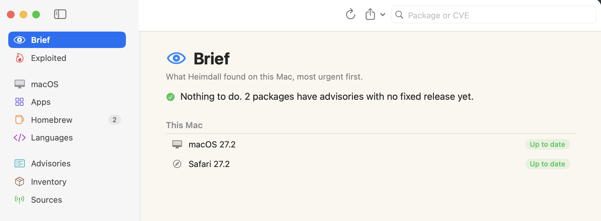
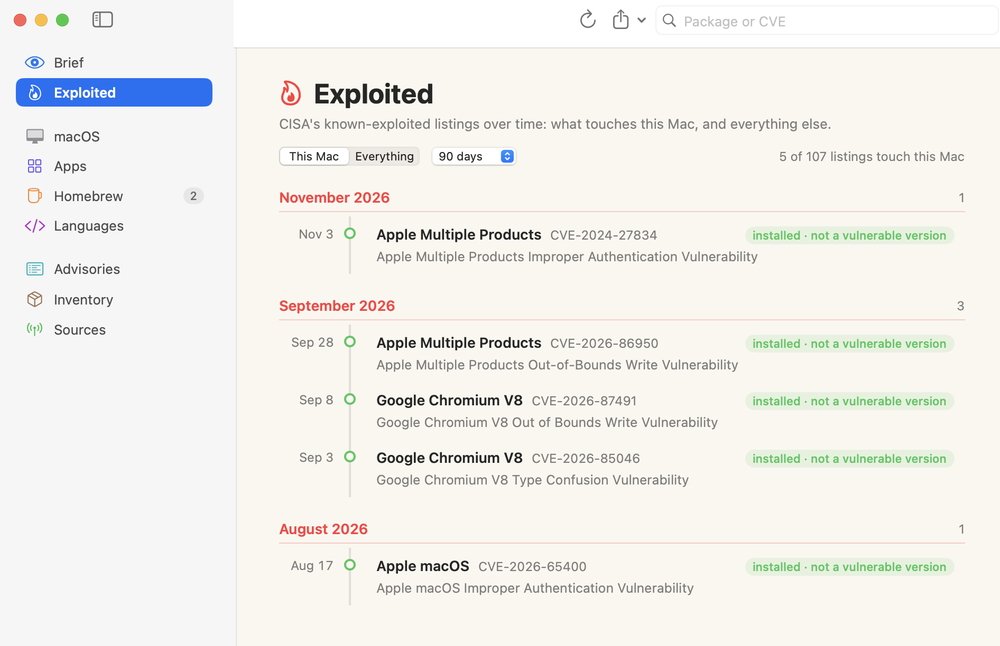

# Heimdall

Heimdall is a native macOS app that inventories the software on your Mac and checks it against published vulnerabilities. Anything on CISA's Known Exploited Vulnerabilities (KEV) list goes to the top of the page. The interface is a native Mac layout in the spirit of Things: a sidebar of sections, a quiet one-line verdict, and rows that open into cards. 

Claude acted as the development agent, with human analysis driving the need.

| Brief | Exploited timeline |
|---|---|
|  |  |
| A one-line verdict, the packages behind it, updates available, and macOS and Safari status. | CISA's exploited listings over time. **This Mac** shows only what touches your installed software; **Everything** shows the whole feed. |

It runs entirely as **your user account**. You don't need root, an admin password, Full Disk Access or a helper daemon. Heimdall reads metadata your account can already read, and it never changes anything.

## Sources

| Installed software | Read from | Checked against |
|---|---|---|
| macOS, Safari | `SystemVersion.plist`, `Info.plist` | Apple security releases and per-release notes, NVD |
| Apps | `Info.plist` in `/Applications`, `~/Applications` | NVD (~70 mapped apps), Chrome Releases, Mozilla MFSA, Microsoft MSRC |
| Homebrew | `brew info --installed` | `brew vulns`, else OSV.dev |
| Python, npm, cargo, gems | package metadata on disk | OSV.dev |
| Go binaries | embedded build info | OSV.dev (Go, incl. `stdlib`) |
| Browser extensions | Chromium and Firefox profiles | malicious-extension list |

Every advisory is then checked for **exploitation** (CISA KEV, MSRC, EUVD, VulnCheck, CISA SSVC), **public exploits** (Exploit-DB, Metasploit, nuclei), **likelihood** (FIRST EPSS) and missing scores (cvelistV5, CISA Vulnrichment). Sparkle feeds, the App Store and Homebrew's cask index flag **newer versions**, and 14 **news** feeds are matched to what's installed. The icon turns red while anything exploited is installed.

What's sent where, response limits, and per-app CPE mappings: [docs/OVERVIEW.md](docs/OVERVIEW.md).

## Build

You need macOS 14 or later and Swift 5.10 or later (Xcode or the Command Line Tools).

```bash
git clone https://github.com/rgregory/heimdall.git && cd heimdall
scripts/build-app.sh            # → build/Heimdall.app and build/heimdall-scan
scripts/build-app.sh --install  # …and copies the app to ~/Applications
```

For development, `swift run Heimdall` runs the app and `swift test` runs the core tests. To work in Xcode, open `Package.swift`.

The app is signed ad hoc, so the first launch needs a right-click → **Open**.

## Using it

- **⌘R** scans. The first scan without an NVD API key takes a few minutes, because NVD allows 5 requests per 30 s. Answers are cached for a day. A free key (Settings → Matching) is kept in your login keychain.
- **Brief:** the exploited flaws to fix first, each with a copyable fix command, then this Mac's macOS and Safari status, counts by severity and by section, and what changed since the last scan.
- **Exploited:** a timeline of CISA KEV listings, grouped by month, with same-day listings for one product folded into a single line. A red dot means a vulnerable version is installed now; a green ring means the product is installed but no vulnerable version was found. Switch between **This Mac** and **Everything**, and between 30 days, 90 days and 12 months.
- **News:** the last 30 days from SANS ISC, The Hacker News, Krebs, Sophos, Securelist, WeLiveSecurity, Schneier, Troy Hunt, Graham Cluley, Darknet Diaries, USOM (TR-CERT) and RansomLook. Stories that name a CVE open here (red) or software installed here (pink) are highlighted; RansomLook and Darknet Diaries are shown but never matched. Findings that are in the news get an "in the news" tag, and the Brief lists this week's stories about your Mac. Feeds are editable in Settings → News.
- **Section pages** (macOS, Apps, Homebrew, Languages): one row per vulnerable package. Click a row to open it into a card with its fix command and advisories. Click an advisory to see everything about it.
- **Advisories:** every advisory in one sortable list. **Inventory:** everything examined. **Sources:** what was read and how fresh it is.
- Results show up as soon as the fast checks finish. The slower NVD lookups for apps and macOS fill in as they arrive.
- **Ignoring:** right-click an advisory, or use the ⋯ menu on a package. Ignored items stay out of counts and the Dock badge.
- **Export:** JSON (the full report) or CSV (one row per advisory).
- Rescans run automatically every 12 hours while the app is open. You can change that in Settings → Display.

### Headless

```bash
build/heimdall-scan                 # summary to stdout
build/heimdall-scan --json > r.json # full report; exit status 2 if anything known-exploited is present
build/heimdall-scan --save          # also update the report the app shows
NVD_API_KEY=… build/heimdall-scan --no-apps --csv
```

## Layout

```
Sources/HeimdallCore/      collectors, feeds (KEV, OSV, NVD, EPSS, Apple), matching, report store
Sources/Heimdall/          SwiftUI app
Sources/heimdall-scan/     command-line scanner
Tests/HeimdallCoreTests/   version ordering, CVSS, NVD applicability, parsers
```

Data lives in `~/Library/Application Support/Heimdall` (reports, [CPE overrides](docs/OVERVIEW.md#teaching-it-about-more-apps)) and `~/Library/Caches/Heimdall` (feeds; safe to delete).

## Limits

- Only what your account can see. Apps installed per-user elsewhere, system daemons and other users' packages aren't covered.
- Microsoft Office for Mac is left out of NVD matching on purpose. NVD describes Office by release year and channel, not build number, so version matching would be noise.
- Homebrew formulae without `brew vulns` only match when OSV knows the upstream repo and the release tag lines up with the version.
- Go vulnerability data carries no CVSS, so Go findings show as *unrated* unless they're on KEV.

## License

Apache 2.0. See [LICENSE](LICENSE).
