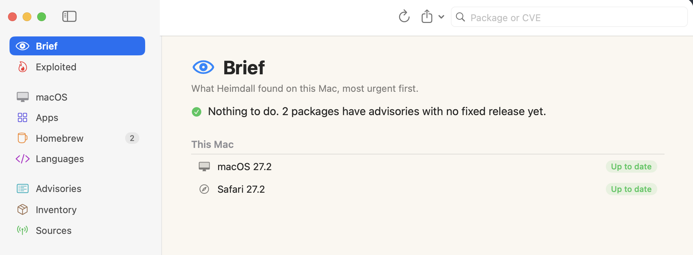
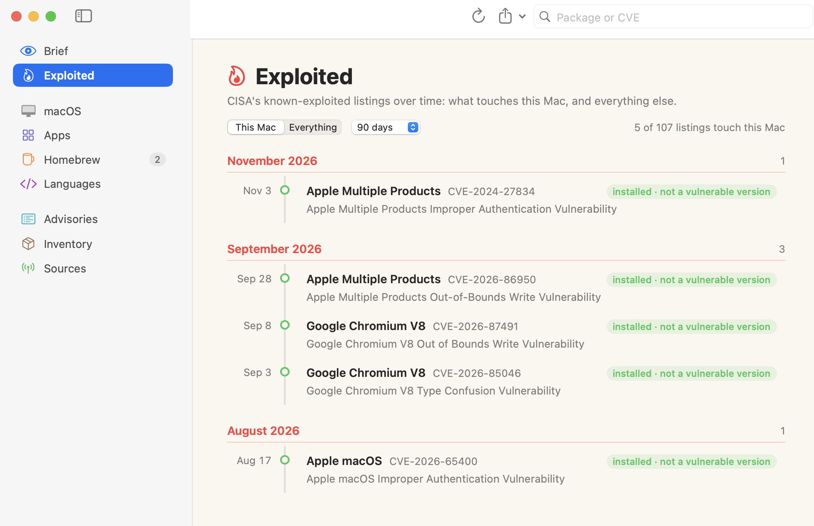

# Heimdall

Heimdall is a macOS app that lists the software on your Mac and checks it against published vulnerabilities. Anything on CISA's Known Exploited Vulnerabilities (KEV) list goes to the top. The layout borrows from Things: a sidebar of sections, a one-line verdict, and rows you click to open.

Claude wrote the code. A person decided what it needed to do and checked the results.

| Brief | Exploited timeline |
|---|---|
|  |  |
| A one-line verdict, the packages behind it, and macOS and Safari status. | CISA's exploited listings over time. This Mac shows only what touches your installed software. Everything shows the whole feed. |

It runs as your normal user account. It doesn't need root, an admin password, Full Disk Access or a helper daemon. It only reads metadata your account can already read, and it never changes anything.

## What it checks

Everything comes from metadata your account can already read: the macOS and Safari version plists, `Info.plist` for apps in `/Applications` and `~/Applications`, the Electron, Chromium, Sparkle, Python and Java runtimes bundled inside those apps, `brew info --installed`, on-disk package metadata for Python, npm, cargo and gems, build info embedded in Go binaries, and Chrome and Firefox extension profiles.

Those are matched against NVD, OSV.dev, `brew vulns`, Apple's per-release security notes, Chrome Releases, Mozilla MFSA, Microsoft MSRC and a list of extensions pulled for malware. Each advisory is then checked for signs of exploitation (CISA KEV, MSRC, EUVD, VulnCheck, CISA SSVC), for public exploit code (Exploit-DB, Metasploit, nuclei) and for its EPSS probability, with missing scores filled in from cvelistV5 or CISA Vulnrichment. The app icon turns red while anything exploited is installed.

An app's own version number says nothing about the engine inside it, so the frameworks it bundles are read separately: an Electron app can call itself current while carrying a browser engine from two years ago.

Three questions about this Mac, rather than about the advisory, then shape what you see. `ps`, `lsof` and launchd say whether each vulnerable thing is running, started at login or listening on a socket. A history file says how long each finding has been open here. Homebrew's deprecation flags, the npm, PyPI and crates.io registries and a table of runtime end-of-life dates say which of them nobody is ever going to fix.

[docs/OVERVIEW.md](docs/OVERVIEW.md) is the full account: what is read and what it is matched against, how rows are ranked, what coverage and "fixed" actually mean, what leaves the Mac, and how to teach it about more apps.

## Build

You need macOS 14 or later and Swift 5.10 or later (Xcode or the Command Line Tools).

```bash
git clone https://github.com/rgregory/heimdall.git && cd heimdall
scripts/build-app.sh            # → build/Heimdall.app and build/heimdall-scan
scripts/build-app.sh --install  # …and copies the app to ~/Applications
```

For development, `swift run Heimdall` runs the app and `swift test` runs the core tests. To work in Xcode, open `Package.swift`.

A local build is signed ad hoc, so the first launch needs a right-click → **Open**. Set `DEVELOPER_ID` (and optionally `NOTARY_PROFILE`) to sign and notarize instead; `scripts/build-app.sh` explains the variables, and pushing a `v*` tag runs the same thing in the Release workflow.

## Using it

- **⌘R** scans. Without an NVD API key the first scan takes a few minutes, because NVD only allows 5 requests every 30 seconds. Answers are cached for a day. You can add a free key in Settings → Matching; it's stored in your login keychain.
- **Brief:** **Fix First** is exploited *and* fixable. **Blocked** is exploited with nothing to install yet — the owner hasn't shipped a build, so it's on the list but not on tonight's list. **Worth Updating** is everything else high or critical. Below that are the macOS and Safari status, counts by severity and section, and what changed since the last scan.
- **Exploited** is a timeline of CISA KEV listings grouped by month, with same-day listings for one product folded into a single line. A red dot means a vulnerable version is installed now; a green ring means the product is installed but no vulnerable version was found. You can switch between This Mac and Everything, and between 30 days, 90 days and 12 months.
- **Not Maintained** is the software nobody is going to fix, where the advice is to remove or replace rather than update. **News** is the last 30 days from 13 security feeds, with stories highlighted when they name a CVE that's open here. The **section pages** (macOS, Apps, Homebrew, Languages) give one row per vulnerable package; click through for how to fix it and which advisories apply, and Languages groups packages under the tool that bundles them. **Advisories**, **Inventory** and **Sources** list every advisory, everything that was checked, and how recent each source is.
- Rows are ordered by risk rather than CVSS alone, and opening one says which signals applied — [Ranking](docs/OVERVIEW.md#ranking) is the list.
- **Verify fix:** open a finding and choose **Verify fix (rescan)** after updating. **Exceptions:** right-click an advisory or use the package menu to defer a finding for 7, 30 or 90 days with a reason, and Settings → Display lists them. Both are deliberately strict about what counts as fixed — [Coverage, remediation and exceptions](docs/OVERVIEW.md#coverage-remediation-and-exceptions) says how strict.
- **Export:** JSON (the full report), CSV (one row per advisory) or a CycloneDX 1.5 SBOM with the vulnerabilities attached, carrying KEV, ransomware and EPSS as properties.
- **Menu bar:** an eye in the menu bar shows the exploited count and opens a panel with the status, the most urgent few findings, Scan Now and Quit. Settings → Display can hide the Dock icon, which turns Heimdall into a menu bar app: it keeps running with the window closed and opens from the panel. The Dock icon can only be hidden while the menu bar item is shown, and neither setting needs a relaunch.
- Results appear as soon as the fast checks finish; the slower NVD lookups for apps and macOS fill in afterwards. While the app is open it rescans every 12 hours, and you can change the interval in Settings → Display.
- **Background:** Settings → Background can install a LaunchAgent in `~/Library/LaunchAgents` that runs the same scan on that interval while the app is closed. It skips itself while the app is open and never asks for the keychain. A notification goes out only when something on a known-exploited list appears that wasn't in the last scan and isn't deferred. The same tab checks GitHub once a day for a newer Heimdall and links to it; nothing is downloaded or installed for you.

### Headless

```bash
build/heimdall-scan                 # summary to stdout
build/heimdall-scan --json > r.json # full report; exit status 2 if anything known-exploited is present
build/heimdall-scan --save          # also update the report the app shows
NVD_API_KEY=… build/heimdall-scan --no-apps --csv
build/heimdall-scan --cyclonedx > heimdall.cdx.json   # SBOM with vulnerabilities
```

## Layout

```
Sources/HeimdallCore/      collectors, feeds (KEV, OSV, NVD, EPSS, Apple), matching, report store
Sources/Heimdall/          SwiftUI app
Sources/heimdall-scan/     command-line scanner
Tests/HeimdallCoreTests/   version ordering, CVSS, NVD applicability, parsers, HTTP transport
```

Data lives in `~/Library/Application Support/Heimdall` (reports, first-sighting history, [CPE overrides](docs/OVERVIEW.md#teaching-it-about-more-apps)) and `~/Library/Caches/Heimdall` (feeds; safe to delete).

Every feed is cached on disk with its own lifetime — an hour for news, 12 hours for KEV and the vendor indexes, a day for NVD searches and update checks, a week for individual CVE records, 30 days for per-release advisory pages. Once an entry expires it is revalidated with `ETag` / `If-Modified-Since` rather than re-downloaded, so an unchanged KEV catalog costs a 304 instead of several MB. Connections are pooled across a scan, so the hundreds of CVE lookups behind a first scan don't each pay for a new TLS handshake. Entries older than 30 days are pruned at launch, and the cache is held under 256 MB oldest-first. The app shows the last report immediately at launch and only rescans when it's older than the interval in Settings → Display.

## Limits

- Heimdall only sees what your account can see. Apps installed elsewhere for one user, system daemons and other users' packages aren't covered.
- "Running" and "listening" are a snapshot taken while the scan ran, and `lsof` only reports this account's sockets without root. Nothing running then doesn't mean nothing ever runs, so it nudges the order rather than deciding it.
- "Checked" describes the matcher that ran, not a guarantee that the software is safe. Inventory shows the outcome per package, and the Brief links to the gaps.
- Office for Mac, Go's missing scores, Homebrew formulae without `brew vulns`, Chromium versions read from inside apps and withdrawn releases all come with caveats of their own: [Limits](docs/OVERVIEW.md#limits) has them.

## License

Apache 2.0. See [LICENSE](LICENSE).
